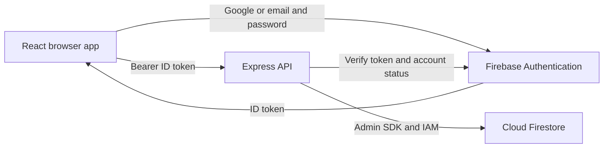

# SpendWise architecture

SpendWise uses a React client, an Express API, Firebase Authentication, and Cloud Firestore. The browser handles authentication with Firebase's SDK; the API handles the financial invariants and data access with Firebase Admin.



## Authentication lifecycle

1. `client/src/lib/firebase.js` initializes the Firebase browser SDK from public web configuration. The private service-account JSON is never imported into the client.
2. Email registration calls `createUserWithEmailAndPassword`, updates the Firebase display name, and refreshes the ID token; email login uses `signInWithEmailAndPassword`. Google sign-in uses `signInWithPopup` with `GoogleAuthProvider` and explicitly requests an account chooser. All three flows request `/api/auth/me` and wait for the verified profile. A failed profile load signs out the newly authenticated identity. Only one manual sign-in can run at a time; popup cancellation and blocked popups restore usable controls with a specific message.
3. `onIdTokenChanged` restores sign-in state on reload and observes sign-in changes from other tabs. The UI waits for the verified profile before rendering protected pages.
4. `request()` attaches the current Firebase user's ID token. A 401 triggers one forced token refresh and retry. Persistent rejection clears only the identity that made the request; an old response cannot sign out a newly selected account or replay a write under it.
5. `requireAuth` calls `verifyIdToken(token, true)`, including project/audience/signature/expiry verification and disabled/revoked-account checks. Only the resulting UID controls a data path.
6. `/api/auth/me` synchronizes the display profile from Firebase Auth. Generation counters prevent late profile responses from restoring a logged-out account. The authenticated layout is keyed by UID so a different account gets fresh page state.
7. Logout calls Firebase `signOut`, clears local application identity, and propagates through the SDK's persistence to other tabs. It does not depend on the expense API being reachable. Revocation in Firebase also blocks further API access.

## Data model

```text
users/{uid}
  name, email, created_at, revision, updated_at
  categories/{id}
    user_id, name, type, created_at
  transactions/{id}
    user_id, category_id, type, amount_paise, description,
    payment_method, transaction_date, created_at, updated_at, import_id (optional)
  budgets/{id}
    user_id, category_id, amount_paise, month, year, created_at, updated_at
  alerts/{budgetId_threshold}
    user_id, budget_id, threshold_percent, message, is_read, created_at
  imports/{importId}
    request_hash, result, created_at
```

Record IDs are Firestore strings. Dates use `YYYY-MM-DD`; timestamps are ISO UTC strings. Amounts and limits are positive integer paise internally and numeric rupees in API responses. `category_id: null` represents an overall budget. Built-in categories have stable `default-expense-*` / `default-income-*` identifiers and are declared in `server/src/data/categories.js`; their API `user_id` is `null` and they cannot be edited.

Firebase Authentication owns credentials. Firestore stores neither passwords nor application session tokens. The UID in a body or query is rejected by strict schemas instead of influencing ownership.

## Consistency and financial rules

`withUserTransaction` first reads the user's profile document, then reads the finance subcollections. Every financial writer updates that root revision and commits its changed documents in one Firestore transaction. Reading the root first serializes mutations across server instances, including duplicate checks on initially empty collections. Firebase retries conflicts up to ten times.

The service callback works on an in-memory snapshot and stages writes. All Firestore reads happen before any writes, including alert calculation, as required by Firestore transactions. Only changed records are written back. Read-only reports receive a consistent snapshot.

- Category uniqueness is per user and type, including built-in names, after case normalization.
- A referenced custom category cannot be deleted or change type. Renaming is allowed; transaction and report names are resolved from the current category.
- Transaction categories must be available to the current user and match the transaction's type.
- A budget is unique for `(category_id, month, year)` within the current user's namespace. Only expense categories can be budgeted.
- Budget spending includes only expense records in the exact calendar month and category scope.
- All mutations that affect spending or budgets recompute threshold crossings atomically.
- Alert IDs combine a budget ID and threshold. The same threshold cannot generate duplicate history.
- Status is `NORMAL` below 75%, `WARNING` from 75%, `HIGH` from 90%, and `EXCEEDED` from 100%. Status and alerts compare integer paise, not rounded percentages.
- Decreased spending preserves history and marks alerts inactive. Changing a budget's category/month/year resets that scope's history. Changing only its amount preserves history. Deleting a budget deletes its alerts in the same commit.

Reports zero-fill six calendar months and every day in the requested month, including leap years. Income is excluded from expense charts and budget spending. All summaries use integer-paise sums.

The current query strategy loads relevant collections for one user, then applies filters, substring search, sort, and pagination. It avoids cross-user scans and extra composite indexes. Indexed period queries and aggregate documents are the next step for much larger histories.

## CSV import and exports

Papa Parse reads CSV locally, preserves quoted fields, and detects comma/semicolon/tab delimiters. The client limits a file to 1 MB and 400 transaction rows, offers explicit field/date mapping, normalizes INR amounts, and suggests only existing categories of the correct transaction type. Known category names take precedence over description keywords; tied or missing suggestions require review. Suggestions use built-in rules without an external model or API key.

`POST /api/transactions/import/preview` accepts selected rows with source-row numbers and returns field errors, duplicate matches, and exact-paise totals without writing. A duplicate fingerprint combines date, type, integer amount, category, payment method, and the description after Unicode/case/whitespace normalization. The client invalidates the preview when the selected rows or duplicate preference change.

`POST /api/transactions/import` strictly validates the rows again and recomputes duplicates inside `withUserTransaction`. Saving stages all new records and refreshed budget alerts, plus a receipt at `users/{uid}/imports/{importId}` in the same commit. The receipt contains the normalized request's SHA-256 hash and result. Concurrent or interrupted retries with the same UUID return the saved result with `replayed: true`; changed rows with a reused UUID return 409. A preflight guard rejects batches exceeding 500 staged writes including the profile and receipt. Invalid or stale category references abort the entire batch.

`GET /api/transactions/export` applies the same validated filters and sorting as the transaction list but omits pagination, using a single snapshot. The client emits UTF-8 CSV with quoted fields and formula protection. Reports obtain a fresh `/api/dashboard/summary` response for each CSV or PDF download, keeping all sections consistent. PDFMake and embedded Roboto fonts are dynamically imported only for PDF export. Tables and three vector SVG charts use a fixed A4 paper layout and paginate independently of the screen theme or viewport.

## API contracts

Success: `{ "data": ... }`. A transaction list also includes `{ "meta": { "page", "page_size", "total", "total_pages" } }`. Deletion returns 204. Validation errors return 422 and field details; unavailable/foreign IDs return 404; forbidden built-in edits return 403; duplicates or category references return 409; unauthenticated requests return 401.

Example expense body:

```json
{
  "category_id": "default-expense-1",
  "type": "EXPENSE",
  "amount": 125.5,
  "description": "Lunch",
  "payment_method": "UPI",
  "transaction_date": "2026-11-06"
}
```

Allowed payment methods: `UPI`, `CASH`, `DEBIT_CARD`, `CREDIT_CARD`, `BANK_TRANSFER`, `OTHER`. Monetary input permits at most two decimal places and a maximum of 9,999,999,999.99 rupees. Calendar dates are constrained to 2000–2100. Query fields and sorting are allowlisted. Request bodies are limited to 32 KB, with a 2 MB exception for the CSV import preview/commit routes; those routes additionally enforce the shared 400-row limit.

## Configuration and access control

The root `.env` is the only local configuration file. Vite maps the seven public Firebase web fields explicitly. The API supports a private JSON path, inline server credentials, or Application Default Credentials. A JSON file must match the configured project. Secret files are excluded from Git and static hosting.

The browser sends bearer headers with `credentials: omit`; there is no application cookie authentication. CORS accepts only `CLIENT_ORIGIN` for browser requests. CSP allows the Firebase Authentication and token refresh endpoints, scripts from `https://apis.google.com`, and authentication frames from `https://*.firebaseapp.com`. COOP is `same-origin-allow-popups` so Google sign-in can communicate with its opener. Production requires an HTTPS origin and rejects emulator settings.

`firestore.rules` denies all direct client reads/writes. The Admin SDK uses IAM and bypasses these client rules, so server ownership and validation checks are mandatory. The rules deployment command backs up the existing release before publishing and verifies the resulting source.

## Test separation

API and browser tests use both Firebase emulators, loopback-only hosts, and a `demo-*` project. Test mode skips loading live `.env` credentials and refuses missing/real-project emulator configuration. Test cleanup deletes only the UIDs or exact generated email belonging to that run. Browser tests block the emulator widget's optional external font/Material assets and wait for its handlers before interacting, avoiding a dependency on public CDN availability. Development and emulator Vite caches are separate; PDF dependencies are prepared before the first request.

Production smoke checks the live connection without modifying app records. It serves the built app through a temporary loopback HTTPS proxy with an in-memory self-signed certificate, then exercises PDF generation with synthetic figures and asserts that no script or CSP errors occur. The production CSP remains intact throughout the browser check.
